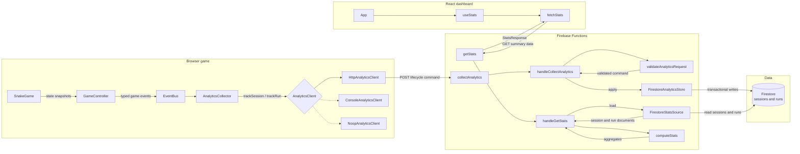

# Neon Snake

A browser snake game. It uses Phaser 3, TypeScript, and Vite. It also uses the Famobi SDK.

## Contents

- [Install and run](#install-and-run)
- [Testing the complete flow](#testing-the-complete-flow)
  - [Automated test coverage](#automated-test-coverage)
- [Architecture](#architecture)
  - [Analytics backend](#analytics-backend)
    - [Sessions and runs](#sessions-and-runs)
  - [Analytics write flow](#analytics-write-flow)
    - [Game events](#game-events)
    - [Collecting data](#collecting-data)
    - [Sending data](#sending-data)
    - [Handling writes](#handling-writes)
  - [Analytics read flow](#analytics-read-flow)
- [Famobi SDK integration](#famobi-sdk-integration)
- [Project structure](#project-structure)
- [Assumptions and limitations](#assumptions-and-limitations)
  - [Assumptions](#assumptions)
  - [Limitations](#limitations)
- [What I would improve with more time](#what-i-would-improve-with-more-time)
- [Tool use disclosure](#tool-use-disclosure)

## Install and run

You need Node.js 22 or newer and pnpm. The Firebase emulators also require Java JDK 11 or newer.

```bash
pnpm install
pnpm backend:install
pnpm dashboard:install
```

Start the game:

```bash
pnpm dev
```

`pnpm dev` checks the types. It builds the page and the standalone `game.js` file. It adds the bundle size to `boot.js`. It then starts Vite preview.

Start the backend and dashboard in separate terminals:

```bash
pnpm emulators
pnpm dashboard:dev
```

The local backend endpoints are:

```text
http://127.0.0.1:5001/demo-neon-snake/us-central1/collectAnalytics
http://127.0.0.1:5001/demo-neon-snake/us-central1/getStats
```

The root `.env.development` sets `VITE_ANALYTICS_URL`. `dashboard/.env.development` sets `VITE_STATS_URL`. Both point to the local backend. Set these variables for deployed builds too.

Run checks, tests, and builds:

```bash
pnpm check
pnpm test
pnpm build
pnpm backend:test
pnpm backend:build
pnpm backend:test:integration
pnpm dashboard:test
pnpm dashboard:build
pnpm test:e2e
```

Run `pnpm preview` to preview an existing production build.

`pnpm backend:test:integration` starts and stops its own Firebase emulators. Stop any emulators started with `pnpm emulators` before running it to avoid port conflicts.

Before the first end-to-end run, install Playwright's browser with `pnpm exec playwright install chromium`. The end-to-end test starts the emulators, game, and dashboard when needed. It clears data from the local Firestore emulator so that its assertions are deterministic.

## Testing the complete flow

For a manual check, start the local game, Firebase emulators, and dashboard as described above. Then:

1. Play several runs. Include a success, a failure, a quit, and different levels.
2. Close the game page to trigger the current run and session end events. Confirm that they reach Firestore.
3. Check the Firestore emulator. Confirm that the session and run documents contain the expected IDs, statuses, scores, levels, and timestamps.
4. Check the dashboard. Confirm that its totals, rates, failure reasons, and level results match the stored documents.

Also complete the checks in [Famobi SDK integration](#famobi-sdk-integration).

The backend integration test automates the HTTP and Firestore part of this flow. `pnpm test:e2e` automates one complete path. It starts a game in a browser, records a failed run, waits for the backend totals, and verifies the dashboard output.

### Automated test coverage

- `pnpm test` runs the game unit tests in `test/unit/`. They cover analytics collection and request creation.
- `pnpm backend:test` runs the backend unit tests in `backend/functions/test/unit/`. They cover validation, handlers, Firestore operations, and statistics.
- `pnpm backend:test:integration` runs the tests in `backend/functions/test/integration/`. They send real HTTP requests through Firebase emulators and check Firestore.
- `pnpm dashboard:test` runs the tests in `dashboard/test/`. They cover API parsing, formatting, React rendering, polling, and tab visibility behavior.
- `pnpm test:e2e` runs the Playwright tests in `e2e/`. They cover the complete browser-to-dashboard flow.

## Architecture

The project has three main parts. The game creates analytics events. The Firebase backend validates and stores them. The React dashboard reads summary data.



### Analytics backend

The backend uses Firebase Functions and Firestore. It exposes two HTTP functions:

- `collectAnalytics` accepts analytics events.
- `getStats` returns data for the dashboard.

Firestore has two top-level collections:

- `sessions` stores game sessions.
- `runs` stores game runs.

#### Sessions and runs

A session is the full time a player has the game open. It starts when the game is ready. It ends when the player closes or leaves the page.

A run is one gameplay attempt. It starts when the player begins playing. It ends when the player completes the level, fails, quits, or closes the page.

One session can contain many runs:

```text
Session starts
  Run 1 -> player hits a wall
  Run 2 -> player completes the level
  Run 3 -> player quits
Session ends
```

Their Firestore document shapes are:

```ts
type SessionDocument = {
  sessionId: string;
  startTime: number;
  endTime: number | null;
  runsPlayed: number;
};

type RunDocument = {
  sessionId: string;
  runId: string;
  level: number;
  startTime: number;
  endTime: number | null;
  score: number;
  status: 'IN_PROGRESS' | 'SUCCESS' | 'FAIL_WALL' | 'FAIL_SELF' | 'QUIT';
};
```

Each run uses `sessionId` to link to its session. All times are epoch milliseconds. The source types are in [`src/shared/analyticsDocument.ts`](src/shared/analyticsDocument.ts).

`collectAnalytics` accepts one command in each `POST` request:

- `SESSION_STARTED`
- `SESSION_ENDED`
- `RUN_STARTED`
- `RUN_ENDED`

The request types are in [`src/shared/analyticsRequest.ts`](src/shared/analyticsRequest.ts).

A successful response reports `created`, `updated`, or `duplicate`. Invalid input returns `400`. Conflicting data returns `409`. An unexpected error returns `500`.

Firestore writes use transactions. Duplicate commands are safe. Commands may also arrive out of order. An end command can create a missing start document. `runsPlayed` increases only once for each finished run.

The browser cannot access Firestore directly. Only the backend uses the Firebase Admin SDK.

### Analytics write flow

The write flow starts with a game state change:

```text
SnakeGame
  -> GameController
  -> EventBus
  -> AnalyticsCollector
  -> HttpAnalyticsClient
  -> collectAnalytics
  -> handleCollectAnalytics
  -> FirestoreAnalyticsStore
  -> Firestore
```

#### Game events

[`GameController`](src/application/GameController.ts) watches game snapshots. Its `handleSnapshot()` method compares the old state with the new state. It emits typed events through `EventBus`.

The main analytics events are:

- `ready` starts a session.
- `runStarted` starts a run.
- `scoreChanged` updates the current score in memory.
- `runEnded` finishes a run.

#### Collecting data

[`AnalyticsCollector`](src/application/analytics/AnalyticsCollector.ts) listens to these events. Its `connect()` method adds the listeners.

The collector creates one session ID. It also creates a new run ID for every run.

On `ready`, it creates a session with `endTime: null`. On `runStarted`, it creates a run with `status: IN_PROGRESS`. On `scoreChanged`, it updates the score in memory. It does not send a request for every score change.

On `runEnded`, `finishRun()` adds the final score, time, and status. The status can be `SUCCESS`, `FAIL_WALL`, `FAIL_SELF`, or `QUIT`.

`endSession()` runs when the page closes. It marks an active run as `QUIT`. It then adds the session end time.

#### Sending data

[`AnalyticsClient`](src/application/analytics/AnalyticsClient.ts) is the transport interface. It has `trackSession()` and `trackRun()` methods.

There are three clients:

- `HttpAnalyticsClient` sends HTTP requests.
- `ConsoleAnalyticsClient` writes data to the browser console.
- `NoopAnalyticsClient` ignores the data.

`HttpAnalyticsClient.trackSession()` creates session commands. `trackRun()` creates run commands. The private `post()` method sends each command to `VITE_ANALYTICS_URL`.

Each command is sent at once. The request uses `keepalive` to help requests finish while the page is closing.

#### Handling writes

The Firebase function is in [`backend/functions/src/index.ts`](backend/functions/src/index.ts). `collectAnalytics` checks the body size. It then calls `handleCollectAnalytics()`.

[`handleCollectAnalytics()`](backend/functions/src/handler.ts) accepts only `POST`. It parses the body. It calls `validateAnalyticsRequest()`. It then calls `store.apply()`.

[`validateAnalyticsRequest()`](backend/functions/src/analyticsValidation.ts) checks all input. It checks IDs, fields, times, scores, levels, and statuses.

[`createFirestoreAnalyticsStore()`](backend/functions/src/firestoreStore.ts) creates the Firestore store. Its `apply()` method selects one transaction:

- `applySessionStarted()` creates a session.
- `applySessionEnded()` finishes a session.
- `applyRunStarted()` creates an active run.
- `applyRunEnded()` finishes a run and updates `runsPlayed`.

The transactions check existing data first. The same command can be sent again safely. Different data with the same ID causes a conflict.

### Analytics read flow

The dashboard reads summary data. It never receives raw session or run documents.

```text
Dashboard App
  -> useStats
  -> fetchStats
  -> getStats
  -> handleGetStats
  -> FirestoreStatsSource
  -> computeStats
  -> Dashboard components
```

[`useStats()`](dashboard/src/useStats.ts) loads the selected date range. It refreshes the data every 30 seconds while the tab is visible. It keeps the old data if a background refresh fails.

[`fetchStats()`](dashboard/src/api/stats.ts) sends a `GET` request. The dashboard offers 7-day, 30-day, and 90-day ranges. It checks the response before returning it to React.

The `getStats` Firebase function calls [`handleGetStats()`](backend/functions/src/statsHandler.ts). This handler checks the HTTP method and the `days` value. The default is 7 days. The maximum is 90 days.

[`createFirestoreStatsSource()`](backend/functions/src/firestoreStatsSource.ts) creates the Firestore reader. Its `load()` method reads sessions and runs in parallel. It filters by `startTime`.

[`computeStats()`](backend/functions/src/stats.ts) builds the response. It calculates:

- Total sessions and runs.
- Finished runs and run success rate.
- Average runs per session for sessions that started in the selected range.
- Average session duration for finished sessions.
- Average score for successful and failed runs. Quit runs are excluded.
- Sessions and runs by day.
- Outcomes and average run duration by level. Run duration includes successful, failed, and quit runs.
- Wall and self-collision failures.

The dashboard calculates run finish rate by dividing finished runs by started runs.

## Famobi SDK integration

The page loads the Famobi SDK from `init.js` in `index.html`. [`public/boot.js`](public/boot.js) passes `game.js` to `GameInterface.init()`. The game starts after SDK setup is complete.

To verify the integration, run the game with browser DevTools open:

| Test | Steps | Expected result |
| --- | --- | --- |
| SDK loaded | Inspect Network and Console. | `init.js` and `game-interface.js` load and the SDK logs startup. |
| SDK initialized | Inspect Console during startup. | `GameInterface.init()` is called before the game starts. |
| SDK controls loading | Open with `?holdInit=1`, then click **START** on the SDK overlay. | `game.js` loads only after clicking **START**. |
| Game waits for SDK | Open with `?holdInit=1`. | Gameplay starts only after initialization is released. |

The loading overlay and retry button belong to the game. The game reports loading progress through `GameInterface.sendPreloadProgress`.

## Project structure

Production code and test code are kept in separate folders. Each application keeps its own tests.

```text
src/                              Game production code
  application/                    Controller, platform, and analytics logic
  core/                           Event bus, audio, and local storage
  game/                           Game rules, levels, input, and Phaser scene
  shared/                         Analytics request and document types
test/unit/                        Game unit tests
  analytics/                     Analytics client and collector tests

backend/functions/
  src/                            Firebase handlers, validation, storage, and stats
  test/unit/                      Backend unit tests
  test/integration/               Firebase emulator integration tests

dashboard/
  src/                            React dashboard production code
  test/                           API, utility, hook, and component tests
    fixtures/                     Shared dashboard test data

e2e/                              Playwright browser-to-dashboard tests
public/boot.js                    Loads the game through the Famobi SDK
```

## Assumptions and limitations

### Assumptions

- One page lifecycle creates one session. A reload creates a new session.
- Only one run is active at a time. Game events arrive in the correct order.
- The browser creates the IDs and timestamps. All reporting days use UTC.
- Date ranges use `startTime`. An `IN_PROGRESS` run counts as a start, but not as a finished run.
- Obstacles count as wall failures. External endings count as quits.
- Analytics does not contain a player or account ID. It uses random session and run IDs.

### Limitations

- Delivery is best effort. There is no local storage, batching, retry queue, or offline recovery. `keepalive` cannot guarantee delivery.
- Analytics errors are only logged. They never stop the game, but failed events may be lost.
- Only one active run is stored in memory. A second start event would replace it.
- Final data cannot be corrected. A different result for the same finished run returns a conflict.
- Both backend endpoints are public and have no authentication. Valid-looking fake events are possible, and the stats endpoint can be called freely and generate Firestore reads.
- Browser clocks may be wrong. This can place data in the wrong reporting day.
- Stats aggregate at most 20,000 sessions and 20,000 runs. Each query reads one extra document to detect truncation. This is an estimated safety cap for response time, memory use, and Firestore cost. Over 90 days, it allows about `20,000 / 90 = 222` runs per day before run results are truncated. The value is not based on production traffic or benchmarks. There is no pagination or pre-aggregation.
- Session and run queries are separate. A write between them can create a short-lived mismatch.
- The dashboard polls every 30 seconds. Backend responses may be cached for 60 seconds.
- Failure categories are limited. Walls and obstacles share one status. Quits and external endings share one status.
- Analytics starts immediately when `VITE_ANALYTICS_URL` is configured. There is no consent gate or privacy notice yet.
- A missing `VITE_ANALYTICS_URL` in production disables collection through `NoopAnalyticsClient`.

## What I would improve with more time

- Protect analytics endpoints with Firebase App Check, authentication, and rate limiting. This would reduce fake or abusive requests.
- Add consent management and a privacy notice. Non-essential analytics would remain disabled until the player opts in.
- Add a scheduled cleanup function for stale sessions and runs. Records that remain in progress for too long could be marked as timed out instead of staying open forever.
- Add retry and offline storage in the game. Failed analytics requests could be saved locally and sent later.
- Add monitoring and alerts. This could detect failed requests, unusual traffic, missing end events, and high error rates.
- Add a data-retention policy. Old raw analytics documents could be archived or deleted automatically.
- Add more dashboard filters. Statistics could be filtered by level, outcome, date, or failure reason.
- Improve accessibility and test the dashboard on more screen sizes and browsers.

## Tool use disclosure

AI-assisted development tools were used to help review the architecture, implement parts of the analytics dashboard, write tests, debug issues, and improve the documentation. All resulting changes were reviewed and tested before inclusion.
