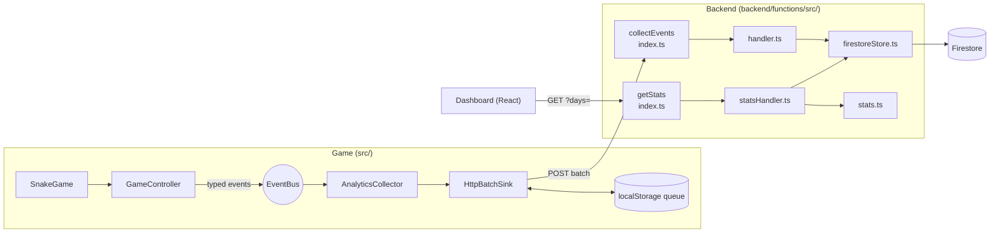

# Neon Snake + Analytics

A browser snake game (Phaser 3, TypeScript, Vite) with an analytics pipeline:

```text
Game  →  collectEvents (Node.js Cloud Function (Firebase's name for a server-side function))  →  Firestore  →  getStats  →  React dashboard
```

- `src/` – the game. It records gameplay events (`session_start`, `run_start`, `run_end`, `run_pause`, `run_resume`, `score_update`).
- `backend/` – Firebase project: two Node.js functions (`collectEvents`, `getStats`), Firestore rules.
- `dashboard/` – React analytics dashboard (level outcomes, daily activity, failure reasons).
- `src/shared/` – the event and stats types used by all three parts.

## Install and run

**Requirements:** Node.js 22+, pnpm, and Java 11+ (the Firestore emulator runs on the JVM).
No Firebase account or real project is needed. Everything runs on the local emulators.

```bash
pnpm install
pnpm backend:install     # backend + firebase-tools
pnpm dashboard:install
```

Then start three processes in separate terminals:

```bash
pnpm emulators           # Functions + Firestore + Emulator UI
pnpm dev                 # the game
pnpm dashboard:dev       # the dashboard
```

Open the local URLs that Vite prints. The env files `.env.development` and `dashboard/.env.development` already point both apps at the emulator.

## Test the complete flow locally

1. Start the emulators, the game and the dashboard as above.
2. Play a few runs in the game: finish a level, crash into a wall, pause, quit to the menu.
3. Open the dashboard. Numbers update on their own while the tab is open (it polls every 30 seconds).
4. Optional: look at the raw data in the Emulator UI at <http://127.0.0.1:4000/firestore>, collection `analytics_events`.

Automated tests:

```bash
pnpm test                       # game: collector and sink
pnpm backend:test               # backend logic, no emulator needed
pnpm backend:test:integration   # backend inside the emulators (needs Java)
pnpm dashboard:test             # dashboard
```

Other checks: `pnpm check` and `pnpm build`.

## Test the Famobi SDK integration

These steps follow the Famobi test catalog ([Start](https://docs.famobi.com/testCatalogStart)). The game loads the Famobi SDK (`init.js`) in `index.html`, and [`public/boot.js`](public/boot.js) then hands the game bundle (`game.js`) to `GameInterface.init()`. The game starts only after `init()` resolves. The backend is not needed for these checks.

Run the application with the browser DevTools open.

| # | Test | Steps | Expected result |
| --- | --- | --- | --- |
| 1 | The SDK must be loaded | Open the page, check the **Network** tab and the **Console**. | `init.js` and `game-interface.js` both load, and the SDK logs its startup message. |
| 2 | The SDK must be initialized | Make sure `GameInterface.init()` is called (it is, in `boot.js`). Check the **Console**. | The console logs that initialization has started. |
| 3 | The game scripts must be loaded via the SDK | Open the page with `?holdInit=1`. Look for the `init hold` log. In **Network**, check that `game.js` has **not** loaded. Click **START** on the SDK overlay. | `game.js` loads only after clicking START. The game bundle has no `<script>` tag of its own in `index.html`. |
| 4 | The game must only start after initialization | Open the page with `?holdInit=1`. Look for the `init hold` log and check that the game does not start. Click **START**. | The game starts only after clicking START (the start call sits in the `init()` resolve callback). |

The loading overlay with a retry button (shown while `game.js` downloads, and again if the download fails) is part of the game, not the SDK. It reports download progress to the SDK with `GameInterface.sendPreloadProgress`.

## Main technical decisions

### Components



`src/shared/` is imported by the game, the backend and the dashboard.

### Key decisions and why

- **Backend is the only door to the data.** The browser never reads Firestore, and the Firestore rules deny all client access. The dashboard calls `getStats`, which reads events with the Firebase Admin SDK and returns only totals.
- **One shared contract.** The game and the backend use the same event and stats types from [`src/shared/`](src/shared/). 
- **Checked twice.** The game creates events only through `AnalyticsCollector`, so wrong types fail the TypeScript build. The backend validates every event again.
- **Game events and analytics are decoupled.** `GameController` emits on an `EventBus`, and `AnalyticsCollector` subscribes to it. A failing sink is caught and logged, so it can never affect gameplay.
- **Reliable delivery.** Events wait in a `localStorage` queue (max 500) and are removed only after the server accepts them. The queue is sent every 5 s, when 20 events are waiting, or right after `run_end`. Network errors, 5xx, 408 and 429 are retried with backoff up to 60 s. Other 4xx responses are dropped because retrying won't help. Requests use `text/plain` to avoid a CORS preflight.
- **Tab closing.** When the page is hidden ([`src/main.ts`](src/main.ts)), an unfinished run is recorded as `quit` and the queue is sent with `navigator.sendBeacon`, which the browser delivers after the page unloads. If that fails, a `fetch` with `keepalive` is used. Unsent events stay in `localStorage` for the next visit. 
- **Run grouping.** `AnalyticsCollector` sets each run's `runId` to `<sessionId>-<run number>` when the run starts, and every event in that run uses it. The run number comes from the saved profile's total runs. The session id keeps it unique across page loads.
- **Idempotent backend.** Each event is saved under its `eventId` with `create()`. A resent event is counted as a duplicate instead of being stored twice. If storage fails, the function returns 500 so the game retries.
- **Simple stats.** `getStats` reads up to 20,000 recent events for the requested range and aggregates them in memory. If there are more, the response is marked `truncated`. The response also carries a 60 s HTTP `Cache-Control` header, so refreshes don't re-read Firestore.
- **Testable backend.** Handlers depend on small interfaces, so tests use fakes. Only `firestoreStore.ts` implements the Firestore calls.
- **Dashboard.** React, Vite and Recharts. Data logic lives in plain functions (`insights.ts`, `format.ts`) with unit tests. The API response is shape-checked at runtime, so a backend mismatch shows a clear error instead of breaking a chart.

### Validation rules and limits

| Rule | Value |
| --- | --- |
| Event age | not older than 30 days |
| Clock skew allowed (future) | 10 minutes |
| `eventId`, `sessionId`, `runId` | 1–128 characters, only `A-Z a-z 0-9 _ -` (they become Firestore document ids) |
| `level` | integer ≥ 1 |
| `score`, `durationMs` | number ≥ 0 |
| `progress` | number from 0 to 1 |
| Unknown fields | removed before saving |

### Gameplay analytics schema

Every event has these fields:

| Field | Type | Meaning |
| --- | --- | --- |
| `eventId` | string | Unique per event (UUID). Used as the Firestore document id. |
| `name` | string | One of the event names below. |
| `timestamp` | number | When it happened, epoch ms, player's clock. |
| `sessionId` | string | One per page load (UUID). |

Optional fields, and which events use them (**R** = required, **O** = optional, empty = not allowed):

| Event | When it is sent | `runId` | `level` | `outcome` | `failureReason` | `score` | `progress` | `durationMs` | `pauseSource` |
| --- | --- | :-: | :-: | :-: | :-: | :-: | :-: | :-: | :-: |
| `session_start` | The game is ready | | | | | | | | |
| `run_start` | A run begins | R | R | | | | | | |
| `score_update` | Score goes up during a run | R | R | | | R | | | |
| `run_pause` | Run paused | R | R | | | | | | O |
| `run_resume` | Run resumed | R | R | | | | | | O |
| `run_end` | Run finished, or page hidden mid-run | R | R | R | O | R | R | R | |

Allowed values:

- `outcome`: `complete` (level cleared), `fail` (player died), `quit` (left the run or closed the page).
- `failureReason`: `wall`, `snake` (hit its own trail), `obstacle`, `external`. Only allowed when `outcome` is `fail`.
- `pauseSource`: `player` or `system` (for example the tab lost focus).
- `runId` has the form `<sessionId>-<run number>` and links `run_start` to its `run_end`.

Example:

```json
{
  "eventId": "7c1f0c52-6f1e-4c8e-9a53-0d6d6f6c1a11",
  "name": "run_end",
  "timestamp": 1760000042000,
  "sessionId": "a3b9c1d2-0e4f-4a6b-8c7d-1e2f3a4b5c6d",
  "runId": "a3b9c1d2-0e4f-4a6b-8c7d-1e2f3a4b5c6d-3",
  "level": 2,
  "outcome": "fail",
  "failureReason": "wall",
  "score": 140,
  "progress": 0.6,
  "durationMs": 42000
}
```

## Assumptions and known limitations

- Local only. There is no deployment setup for a real Firebase project.
- `collectEvents` and `getStats` are unauthenticated and use open CORS. This is fine on the emulator. For production, add authentication or App Check, rate limiting, and a fixed list of allowed origins.
- Players are anonymous. A session id is generated in the browser, and no personal data is collected.
- `getStats` reads events from Firestore on each request (cached for 60 s) and does the aggregation in memory. This is fine for demo volumes. A large dataset would need pre-aggregated counters.
- The dashboard refreshes by polling, not by live updates.
- Emulator data is lost when the emulators stop.
- Outside the Famobi host the Famobi SDK logs an error in the console. The game still works.

## License

MIT
